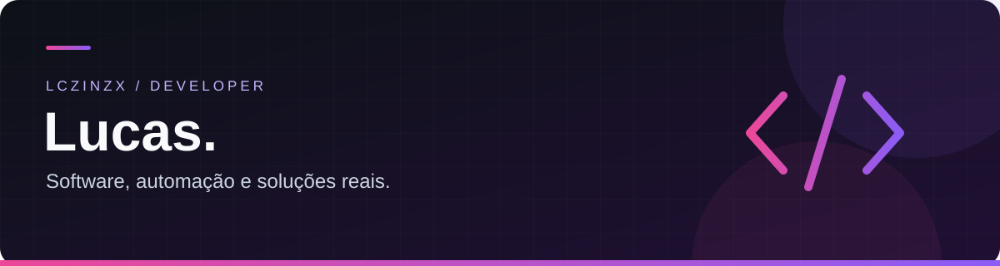

# Olá, eu sou o Lucas 👋
### Desenvolvedor de Software

**⚙️ Automação e produtividade · 🎮 Ferramentas para games**

Duas frentes de desenvolvimento. Projetos separados. O mesmo foco em ferramentas úteis.

---

## Sobre mim

Atuo em duas frentes: **automação de processos e produtividade**, para simplificar operações e reduzir trabalho manual, e **ferramentas para games**, uma nova área voltada a utilitários para jogadores.

[⚙️ Ver automações](#automacoes) · [🎮 Ver ferramentas para games](#games)

Meu foco está em aplicações práticas, com atenção à experiência de uso, sincronização entre computadores e preservação das funcionalidades existentes. Uso IA como apoio para desenvolver, testar e evoluir meus projetos, aprendendo com cada desafio.

## ⚙️ Automação e produtividade

Soluções para automatizar tarefas, organizar informações e conectar operações.

### Projeto em destaque — Festum Estação

**Uma operação conectada. Várias ferramentas. Um só lugar.**

Uma estação de ferramentas para operações reais, reunindo:

- **Automação de produção:** importação de pedidos, identificação de SKUs e organização de arquivos.
- **Gestão operacional:** estoque, reenvios, histórico e planilhas.
- **Comunicação interna:** conversas individuais, grupos, anexos e notificações.
- **Ferramentas de criação:** organização de imagens e bibliotecas de produção.
- **Uso multiplataforma:** Windows, macOS, Android e web para iPhone.
- **Sincronização multi-PC:** informações compartilhadas entre as estações da equipe.

> O código do aplicativo é privado. O repositório público de releases disponibiliza suas versões distribuídas.

### Repositórios de automação

| Repositório | Finalidade |
| :--- | :--- |
| [estacao-releases](https://github.com/Lczinzx/estacao-releases) | Instaladores e atualizações do Festum Estação. |
| [lx-syncmarkteplace](https://github.com/Lczinzx/lx-syncmarkteplace) | Projeto de ferramentas e integrações para marketplace. |

O código-fonte do Festum permanece privado; somente a distribuição é pública.

---

## 🎮 Ferramentas para games

Uma frente separada das automações empresariais: utilitários e ferramentas voltados a jogos e à experiência dos jogadores.

### Repositórios de games

**Novos projetos em preparação.** Os repositórios públicos desta área serão apresentados aqui conforme forem publicados.

Ainda não há repositórios públicos de games neste perfil. Esta seção fica reservada para eles, sem misturar os projetos de automação.

---

## 🧰 Tecnologias nos meus projetos

| Área | Tecnologias |
| :--- | :--- |
| Interface | React · TypeScript · Tailwind CSS |
| Aplicações desktop | Tauri · Rust |
| Dados e integrações | Supabase · PostgreSQL |
| Testes | Vitest · Testing Library |
| Versionamento e distribuição | Git · GitHub · GitHub Actions |

## 🎯 O que busco construir

**Automação para o trabalho. Ferramentas para os games. Software para resolver problemas.**

Gosto de transformar uma necessidade concreta em um fluxo mais simples — do primeiro protótipo até o uso diário — e evoluir o sistema com testes e mudanças cuidadosas.

---

**Construindo, aprendendo e melhorando um projeto de cada vez.**

