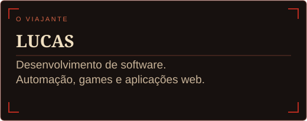
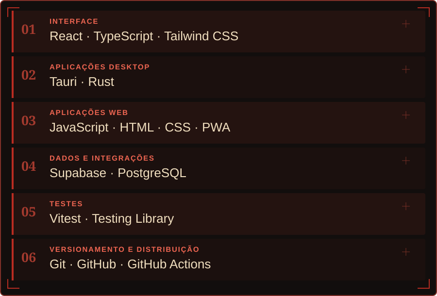

<a href="https://tenor.com/view/rdr2-arthur-morgan-horse-riding-horse-walking-horse-gif-19842663">
<picture>
  <source media="(prefers-reduced-motion: reduce)" srcset="assets/rdr2-panorama-red-still.png" />
  
</picture>
</a>

 

<picture>
  <source media="(prefers-reduced-motion: reduce)" srcset="assets/frontier-greeting-still.png" />
  
</picture>

**Desenvolvedor de Software · Automação de Processos · Aplicações Multiplataforma**

 

 

<picture>
  <source media="(prefers-reduced-motion: reduce)" srcset="assets/frontier-trail-still.png" />
  
</picture>

## 

Uso IA como apoio para desenvolver, testar e evoluir os projetos, aprendendo com cada desafio.

<table>
<tr>
<td width="50%"></td>
<td width="50%"></td>
</tr>
</table>

### Três frentes de desenvolvimento

**Automação e produtividade** — simplificar processos, organizar operações e conectar ferramentas. O Festum Estação é o projeto principal desta frente.

**Ferramentas para games** — interfaces em português e utilitários voltados à experiência dos jogadores. O **lxmenu está pausado**, em revisão e sem novas publicações.

**Aplicações web** — sites, interfaces responsivas e aplicações instaláveis como PWA. O **LX Play está pausado**, em revisão e sem novas publicações.

 

## 

| Na operação | No aplicativo |
| :--- | :--- |
| **Produção** | Importação de pedidos, identificação de SKUs e organização de arquivos. |
| **Gestão** | Estoque, reenvios, histórico e planilhas. |
| **Criação** | Ferramentas de imagens e bibliotecas de produção. |
| **Equipe** | Conversas individuais, grupos, anexos, notificações e sincronização entre computadores. |
| **Multiplataforma** | Windows, macOS, Android e interface web para iPhone. |

O código-fonte do Festum é privado. O repositório público disponibiliza os instaladores e as atualizações.

 

## 

 

## 

<b>✦ Abrir o diário de fronteira</b>

 

**01 · Observar a operação**

- Transformar necessidades do dia a dia em ferramentas práticas.
- Criar interfaces claras e em português.

**02 · Construir com cuidado**

- Testar cada mudança e preservar o que já foi aprovado.
- Aprender durante o desenvolvimento e melhorar um projeto de cada vez.

 

## 

Uma sugestão ou um problema com o Festum? Abra uma issue no projeto com a versão, o dispositivo e os passos para reproduzir. Remova senhas, tokens e dados pessoais dos anexos públicos.

<b>✦ Apoie o desenvolvimento</b>

 

Você pode apoiar os projetos com testes, sugestões e relatos de problemas.

**Doações não estão ativadas.** O suporte não depende de contribuição financeira.

 
<picture>
  <source media="(prefers-reduced-motion: reduce)" srcset="assets/frontier-trail-still.png" />
  
</picture>

 

---

LCZINZX2006 &nbsp; · &nbsp; UM PROJETO DE CADA VEZ.

