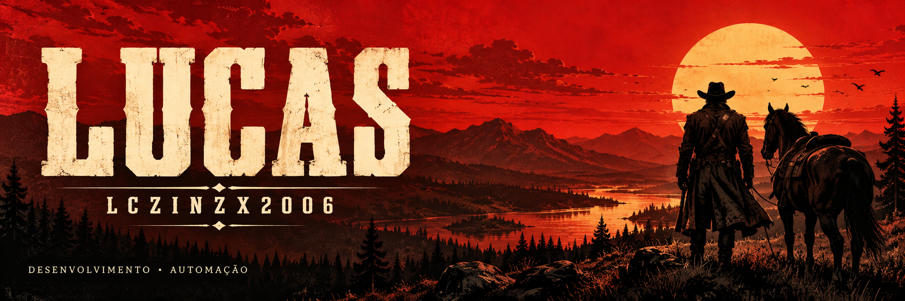

 

### Código, ferramentas e novas fronteiras.

**Lucas · Desenvolvimento de software · Automação**

[Festum Estação](https://github.com/Lczinzx2006/estacao-releases) &nbsp; / &nbsp; [Downloads](https://github.com/Lczinzx2006/estacao-releases/releases) &nbsp; / &nbsp; [Suporte](https://github.com/Lczinzx2006/estacao-releases/issues)

 

## No caminho

Sou o Lucas. Desenvolvo ferramentas para simplificar o trabalho: automatizar processos, organizar informações e conectar aplicações entre computadores.

Meu projeto principal é o **Festum Estação**, uma aplicação que reúne ferramentas de produção, gestão e criação. Vou evoluindo o projeto com testes, uso real e cuidado para preservar os fluxos que já funcionam.

 

## Projeto em destaque

| Na operação | No aplicativo |
| :--- | :--- |
| **Produção** | Importação de pedidos, identificação de SKUs e organização de arquivos. |
| **Gestão** | Estoque, reenvios, histórico e planilhas. |
| **Criação** | Ferramentas de imagens e bibliotecas de produção. |
| **Equipe** | Comunicação interna e sincronização entre computadores. |

[**Baixar o Festum Estação →**](https://github.com/Lczinzx2006/estacao-releases/releases)

O código-fonte do Festum é privado. O repositório público disponibiliza os instaladores e as atualizações.

 

## Na mochila

 

## Diário de desenvolvimento

<b>Abrir o diário</b>

 

- Transformar necessidades do dia a dia em ferramentas práticas.
- Criar interfaces claras e em português.
- Testar cada mudança e preservar o que já foi aprovado.
- Aprender durante o desenvolvimento e melhorar um projeto de cada vez.

 

---

LCZINZX2006 &nbsp; · &nbsp; UM PROJETO DE CADA VEZ.

